# ADR-003: Lock-Free Optimistic Concurrency Control (CAS), Zero-FD Symlink Leases & Instant `ESRCH` Crash Recovery

- **Status:** Accepted
- **Phase:** 3 (`0xdead10cc`-Proof Lock-Free Storage, Symlink CAS Engine & Maildir Queue)
- **Applies To:** `package:extension_bridge` (`lib/src/storage/atomic_state_store.dart`, `lib/src/protocol/cas_lease_token.dart`) and `ExtensionBridgeCore` (Swift 6)

---

## 1. Context & Problem Statement

When multiple processes (the Flutter host app, a `WidgetKit` extension, an iOS 17+ `AppIntent`, or an iOS 18 `ControlWidget`) concurrently execute read-modify-write updates (`store.update((current) => ...)`) on the same `@SharedState` key:
1. We must guarantee **linearizable, conflict-free updates** (zero lost updates) using monotonic generation numbers (`_gen`).
2. We must **never** hold an open file descriptor lock (`flock`/`fcntl`) that could trigger iOS `0xdead10cc` process termination if SpringBoard suspends the writer.
3. If an extension is abruptly terminated mid-write via `SIGKILL` or Jetsam OOM (`EXC_RESOURCE`), contending writers must recover **immediately (< 1 ms)** without waiting for a multi-second lock timeout, while also preventing **split-brain overwrites** if a live writer experiences a long CPU/GC pause.

---

## 2. Decision: Out-of-Band `.tmp` Serialization + Zero-FD Atomic `.cas` Symlink Lease

### 2.1 Zero-Lock Snapshot Reads
Readers never acquire any lease or lock:
1. **Stage 1 (`notify_check` ~299 ns):** Reads `notifyd`'s shared-memory (`shm`) generation slot. If `check == 0`, returns the cached in-memory model immediately.
2. **Stage 2 (`notify_get_state` ~9.3 µs):** If `check == 1`, reads the 64-bit `KernelStateRegister`. If `reg.hasValidMagic && reg.generation <= cachedGen`, returns the cached model.
3. **Stage 3 (Lock-Free APFS Read):** Opens `state/<key>.v<version>.json` and reads the immutable file bytes. Because writers only mutate state by staging a new `.tmp` file and calling POSIX `rename(2)`, an open reader's file descriptor always points to a complete, self-consistent APFS inode.

### 2.2 The 8-Step Monotonic CAS Write Protocol

```mermaid
stateDiagram-v2
    [*] --> ReadSnapshot: 1. Read expectedGen from state/<key>.v1.json (0 if absent)
    ReadSnapshot --> RunMutator: 2. Execute pure mutator(current) -> nextValue, nextGen = expectedGen + 1
    RunMutator --> StageTmp: 3. Out-of-band: clonefile() blobs + write & fsync .<key>.v1.tmp.<pid>_<ts>_<nonce>
    StageTmp --> AcquireSymlink: 4. symlink("<pid>:<ts_us>:<nonce>", ".<key>.v1.cas")
    AcquireSymlink --> InspectHolder: EEXIST (Lease Contention)
    InspectHolder --> EvictLease: kill(holderPid, 0) == ESRCH OR age > 2000 ms (owner-verified unlink)
    EvictLease --> AcquireSymlink: Retry symlink()
    InspectHolder --> RollbackAndRetry: Holder PID alive & age <= 2000 ms
    AcquireSymlink --> VerifyGen: Symlink Acquired (< 15 µs critical section begins)
    VerifyGen --> RollbackAndRetry: diskGen != expectedGen (Concurrent writer won)
    VerifyGen --> VerifyOwner: diskGen == expectedGen
    VerifyOwner --> RollbackAndRetry: readlink(".cas") != myLease (Split-brain guard)
    VerifyOwner --> AtomicRename: readlink(".cas") == myLease
    AtomicRename --> BroadcastNotify: 7. rename(.tmp, .json) + owner-verified unlink(.cas)
    RollbackAndRetry --> ReadSnapshot: Unlink .tmp & staged blobs; increment attempt
    BroadcastNotify --> [*]: 8. notify_set_state + notify_post + GC blobs (< gen - 2)
```

### 2.3 Why `symlink(2)` Instead of a Lock File?
In POSIX/APFS, `symlink(target, linkPath)` is a **single atomic kernel directory operation** that embeds the lease metadata (`"<pid>:<acquiredAtMicros>:<nonce>"`) directly inside the symlink's target string:
- **Zero Open File Descriptors:** Creating, reading (`readlink`), and deleting (`unlink`) a symlink opens **0 file descriptors** (`0xdead10cc`-proof).
- **Zero Race Window Between Creation and Metadata Write:** With a regular lock file (`open(O_CREAT | O_EXCL)` followed by `write(pid)`), a contender inspecting the file between `open()` and `write()` sees an empty `0`-byte file and cannot tell which PID owns it. A symlink's target payload is populated atomically at creation time.

### 2.4 Instant Dead-Process Eviction (`kill(pid, 0) == ESRCH`)
When `symlink(..., ".<key>.v1.cas")` returns `EEXIST`:
1. The contender calls `readlink(".<key>.v1.cas")` to read `holderRaw = "<pid>:<ts_us>:<nonce>"`.
2. It probes the Darwin kernel process table via `kill(holder.pid, 0)`:
   - **`errno == ESRCH` (No Such Process):** The holder extension was terminated by `SIGKILL` or Jetsam OOM. The contender verifies `readlink(".cas") == holderRaw`, calls `unlink(".cas")`, and acquires the lease in **< 1 ms**.
   - **Process Alive (`kill == 0` or `errno == EPERM`):** The holder is still running. Since all serialization and `fsync` happened out-of-band in Step 3 before acquiring `.cas`, a healthy holder finishes its critical section in **< 15 µs**. Only if `nowMicros - holder.acquiredAtMicros > 2,000,000` (2,000 ms ceiling) does the contender evict the lease as expired.

### 2.5 Split-Brain Immunity via Owner-Token Verification
Suppose Writer $A$ acquires `.cas`, then suffers an extreme 2.5-second CPU stall before calling `rename(2)`. During that pause, Writer $B$ sees that $A$'s lease exceeded 2,000 ms, evicts `.cas`, acquires its own lease `myLease_B`, and commits generation $G+1$.
When Writer $A$ wakes up:
- Before calling `rename(2)` or `unlink(".cas")`, Writer $A$ checks `readlink(".cas") == myLease_A.encode()`.
- Seeing `myLease_B != myLease_A`, Writer $A$ immediately aborts its commit, leaves `.cas` and the snapshot untouched, unlinks its own `.tmp` file, and retries from Step 1 (`splitBrainPreventedCount += 1`).
