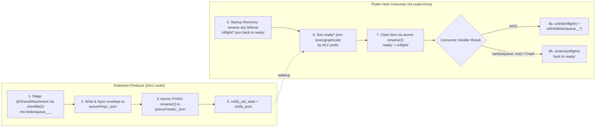

# ADR-004: Lock-Free Maildir `@SharedQueue`, Hybrid Logical Clocks & APFS `clonefile(2)` Blob Lifecycle

- **Status:** Accepted
- **Phase:** 3 (`0xdead10cc`-Proof Lock-Free Storage, Symlink CAS Engine & Maildir Queue)
- **Applies To:** `package:extension_bridge` (`lib/src/storage/shared_queue.dart`, `lib/src/storage/shared_attachment_manager.dart`, `lib/src/ffi/apfs_clonefile.dart`, `lib/src/protocol/hybrid_logical_clock.dart`) and `ExtensionBridgeCore` (Swift 6)

---

## 1. Context & Problem Statement

iOS Share Extensions, Action Extensions, and Interactive Widgets frequently need to enqueue events or large media attachments (such as 4K videos and burst HEIC photos from Apple Photos) while the Flutter host application is suspended or terminated.

Two systems constraints make naive queues fail on iOS:
1. **16–30 MB Extension Jetsam RAM Ceiling (`EXC_RESOURCE`):** Reading and rewriting a single shared JSON queue file—or copying a 200 MB video buffer in memory—immediately exceeds the extension memory limit and crashes the extension.
2. **Concurrent Multi-Extension Producers:** A user may trigger an Interactive Widget button while a Share Extension or background `AppIntent` is simultaneously enqueueing an item.

---

## 2. Decision: HLC-Ordered Maildir State Machine + APFS `clonefile(2)`

### 2.1 Lock-Free Maildir Directory State Machine (`tmp/` → `ready/` → `inflight/`)

Inspired by Daniel J. Bernstein's lock-free `Maildir` specification, each `@SharedQueue` manages three subdirectories under `<AppGroup>/extension_bridge/queue/<queueKey>/`:



### 2.2 Causal & Chronological Ordering via Hybrid Logical Clocks (`HlcTimestamp`)
Every queue file is named using a fixed-width 22-character Hybrid Logical Clock prefix followed by the unique item ID:
```text
00001729800000123_0001_48219_1_7a9f1c.json
└────── 17d ────┘ └4h┘ └──── itemId ─────┘
  wallTimeMicros  counter
```
- When multiple events are enqueued within the same physical microsecond—or if NTP adjusts the system wall clock backward—`HybridLogicalClock` increments the 4-digit hexadecimal `logicalCounter` (`0000`..`ffff`), guaranteeing strict monotonicity (`t_next > t_prev`).
- Standard lexicographical sorting of directory filenames in `ready/` yields exact causal and chronological order **without opening or parsing JSON files**.

### 2.3 Zero-Copy Media Staging via APFS `clonefile(2)` (`CLONE_NOOWNERCOPY`)
When a `@BridgeModel` contains a `@SharedAttachment()` field:
1. `SharedAttachmentManager` invokes Darwin's `<sys/clonefile.h>` syscall:
   ```c
   clonefile(srcPath, stagingBlobPath, CLONE_NOOWNERCOPY /* 0x0002 */);
   rename(stagingBlobPath, finalBlobPath);
   ```
2. On APFS (all iOS devices and macOS volumes), `clonefile(2)` creates a **Copy-on-Write (CoW) inode clone** that shares the physical data extents on disk:
   - **Disk Overhead:** `0` additional bytes.
   - **Memory Overhead:** `< 50 KB` of RAM (safe inside a 16 MB extension).
   - **Execution Time:** `~0.3 ms` independent of file size (even for a 200 MB 4K `.mov`).
   - **Why `CLONE_NOOWNERCOPY`?** Extension temporary directories and shared App Group containers can have differing BSD ownership metadata; `CLONE_NOOWNERCOPY` prevents `EPERM` errors during cross-container cloning.
   - **Automatic Cross-Volume Fallback:** If `clonefile(2)` returns `EXDEV` (cross-volume mount), `ENOTSUP`, or `ENOSYS`, `ApfsFileCloner` automatically falls back to a 64 KB chunked streaming copy into the `.tmp` staging path before calling `rename(2)`.

### 2.4Deterministic Blob Garbage Collection
- **For `@SharedQueue` Blobs (`blobs/queue_<itemUuid>_<idx>_<name>`):**
  Blobs are retained while the item is in `ready/` or `inflight/` (including across crash recovery redeliveries) and are unlinked immediately when `QueueDelivery.ack()` completes (or when `maxItems` backpressure evicts the oldest `ready/` envelope).
- **For `@SharedState` Blobs (`blobs/state_<key>_gen_<gen>_<nonce>_<name>`):**
  When generation $G$ is committed, `SharedAttachmentManager.gcStaleStateBlobs` unlinks any blob for `<key>` with generation $< G - 2$. Retaining generations $G - 1$ and $G - 2$ guarantees that a concurrent lock-free reader that opened generation $G - 1$ just before generation $G$'s `rename(2)` commit never encounters `ENOENT` when reading its attachment file.
